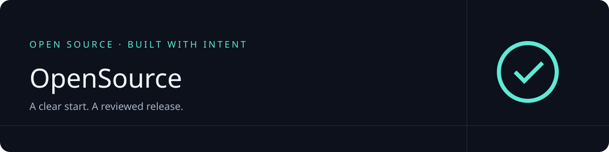

<p align="center">
  
</p>

<p align="center">
  <a href="./LICENSE">Apache-2.0</a> ·
  <a href="./CONTRIBUTING.md">Contributing</a> ·
  <a href="./SECURITY.md">Security</a> ·
  <a href="./docs/ROADMAP.md">Roadmap</a>
</p>

OpenSource creates agent-skill packages, TypeScript packages/workspaces, or
common repository structure without package-specific tooling.
It includes a local generator and a shared skill for Codex and Claude Code.
Package name: `@ottoai/opensource`.

## Status

`0.1.0` release candidate. Not published on npm. The manifest remains private
while account and maintainer-review gates are outstanding.
This is a starter, not a production certification.

## Quick start

Requires Node.js 22.14 or later on macOS or Linux. Node 22 and 24 are the
supported test targets. Native Windows is not supported in this release.
From this checkout:

```sh
npm ci --ignore-scripts
npm run check
node bin/opensource.mjs init ../my-package
```

The first question selects skills, TypeScript, or none (common structure only).
Skill projects select coding hosts and distribution; TypeScript projects select
single/workspace layout and package manager. Names, purpose, MIT/Apache-2.0 license,
and ownership are explicit choices.

Accept shared conventions as a group or customize selected settings.
Publication defaults to deferred. The wizard displays configuration and files,
then asks for confirmation. Irrelevant profile questions are skipped.
The destination must not exist. Nothing is pushed, staged, or published.

For agent or noninteractive use:

```sh
node bin/opensource.mjs init ../my-package --config /path/to/config.json --dry-run
node bin/opensource.mjs init ../my-package --config /path/to/config.json
```

See [configuration](docs/USAGE.md) for the JSON schema.

## Install the skill

```sh
node bin/opensource.mjs install --host codex --project /path/to/project --dry-run
node bin/opensource.mjs install --host codex --project /path/to/project
node bin/opensource.mjs install --host claude-code --project /path/to/project
```

Invoke `$opensource` in Codex or `/opensource` in Claude Code.
The installer copies a self-contained skill, preserves existing files, and does
not change provider credentials or host settings. It refuses an existing install.
Managed installations support `upgrade`, `uninstall`, and `restore`; modified or
unowned skills are preserved. Backups and receipts stay under `.opensource/`.
See [usage](docs/USAGE.md) for recovery and filesystem limitations.

## What it generates

- Skills: one/multiple skill skeletons, selected Codex/Claude Code support,
  optional npm installer, metadata/license checks, and installer tests.
- TypeScript: single package or multi-package workspace, npm/pnpm lockfiles,
  ESM JavaScript/declarations, strict type checks, tests, and archive checks.
- None: common files only; no manifest, skill payloads, compiler, dependency
  lockfile, or npm publishing workflow.
- README with an SVG header; Apache-2.0 or MIT license and ownership notice.
- Contribution and security policies, agent instructions, and docs under `docs/`.
- Profile-aware SHA-pinned CI, issue/PR templates, dependency updates, and optional staging setup.
- Public-package file allowlists and an ignored `.opensource/` development workspace.

Deferred publication keeps publishable manifests private and blocks both local
release checks and the staging workflow. Configured publication prepares templates,
not permission to publish. The staging job consumes reviewed, checksummed archives;
a maintainer must approve stages separately. No credentials are generated.

These are starter structures, not copies of another project's product code or
specialized review policies. Cross-package dependencies and Changesets are not
implemented. Release checks inspect archive inventory and read account protections;
they do not grant publishing authority. See [roadmap](docs/ROADMAP.md).

## License

Apache-2.0. Generated project files use the selected project license.
